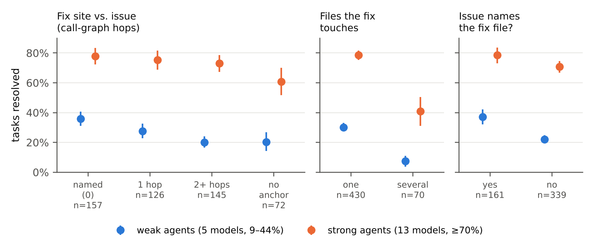
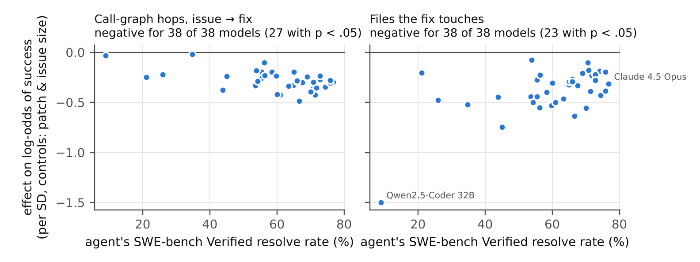
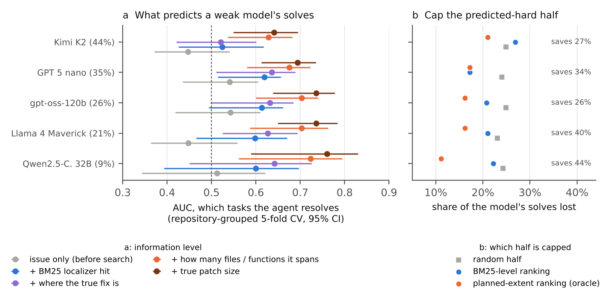
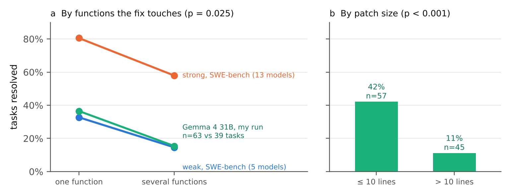
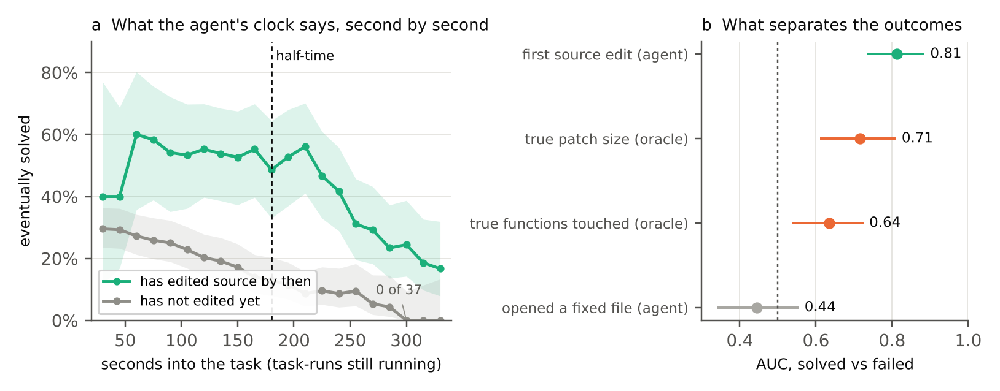

# Where the Fix Lives: Code-Graph Structure and the Triage Gap for Local Agents

**Haresh G.** (Kaggle: Haresh276) · Code, data and all three notebooks: github.com/Haresh276/where-the-fix-lives

## Abstract

Gemma 4 31B fails most of the bugs it is given, and the failures eat most of its 12 hours. I asked what predicts a failure, and how early the agent itself could tell. For 38 models on all 500 SWE-bench Verified tasks, I built code graphs at each base commit. Beyond patch size, failure follows an issue that names nothing connected to the fix (−0.91 [−1.46, −0.40] log-odds) and a fix spanning more files (−0.34 [−0.65, −0.10] per SD). Neither is visible from the issue (AUC 0.45–0.54), and knowing where the fix sits adds little. How big the edit is does separate wins from losses (AUC 0.63–0.72). Then I ran Gemma 4 31B three times on the competition's own tasks and setup, and read every trace. Gemma opens a file the fix changes in 92% of task-runs, after a median of 12 seconds, and that predicts nothing (AUC 0.44). What predicts success is when it first edits source code (AUC 0.81, against 0.71 for the true patch size). At 180 seconds, runs that have edited go on to solve 49%, the rest 13%. A third run with 10 minutes per task instead of 6 solved 30 of 102, between the two 6-minute runs (29 and 32), for 25% more time. Finding the fix is easy for Gemma. Starting to write it is the bottleneck, and more minutes do not fix that.

## 1. Introduction

The competition gives an agent 12 hours on four L4 GPUs and a hidden pile of bugs. In my first full run of Gemma 4 31B on the public tasks, failed tasks took twice as long as solved ones (median 364 s against 180 s) and used 80% of the runtime. Most of the budget goes to bugs the agent was never going to fix.

Patch size is the obvious guess. But two three-line patches can be different jobs: in one the issue names the broken function, in the other the broken line is three calls away from anything the issue mentions. A code graph can measure that, and every agent here already gets graph tools. So I asked three questions.

1. Does **where the fix sits in the code graph** predict failure, beyond patch size and issue length, across many models?
2. Can an agent see that **before** it searches, or only after it has found and planned the fix? I call the difference the *triage gap*.
3. For **Gemma 4 31B on the competition's own tasks**, what can the agent itself notice early enough to act on?

**Related work.** Agent Psychometrics [2] predicts task difficulty from LLM-judged features. Balepur et al. [3] show on synthetic call graphs that understanding code limits agents more than editing it. Agentless [7] and LocAgent [8] treat localization as its own stage. I measure real repository structure instead, compare it with [2], and then look inside the agent's own trajectory.

## 2. Data and method

**Tasks and outcomes.** SWE-bench Verified [4] has 500 human-checked bug fixes from 12 Python repositories (Django alone is 46%). The leaderboard publishes per-task results for 40 runs of the bash-only *mini-SWE-agent* scaffold [5]. I dropped two whose per-task files disagree with their reported score by over 5 points, leaving **38 models** (15 open-weight, 9% to 77% resolved). The runs span 11 scaffold releases, so each gets its own fixed effect. *Weak* means the five models below 45% (Qwen2.5-Coder 32B, Llama 4 Maverick, gpt-oss-120b, GPT-5 nano, Kimi K2). *Strong* means the 13 at 70% or above.

**Code graphs at every commit.** For each task I parse every non-test Python file at its base commit into functions, methods and classes, linked by call edges (resolved by name, which over-approximates) and class-to-method containment. The median graph has 9,308 nodes and the biggest has 31,488.

**Where the fix lives.** I map each task's curated fix spans onto graph nodes (97.5% resolve) and measure the following.

- *Hops*: graph distance from anything the issue names (identifiers, traceback frames) to the fixed code. *No anchor* (72 tasks) means nothing the issue names reaches the fix within 8 hops.
- *Files* and *functions* the fix touches, and whether the issue names the fix *file*.
- Patch lines and issue length, as controls.

*Example.* In `sphinx-doc__sphinx-9591` the fix is three lines in one method, three hops from anything the issue names. All 13 strong models fix it and none of the five weak ones do.

**Analyses.** A pooled logistic model of 19,000 task × model outcomes with run fixed effects and 95% CIs from 1,000 task-level bootstrap resamples; per-model fits; and classifiers of each weak model's solves at rising information levels, with whole repositories held out.

**My Gemma runs.** The public competition tasks are merged pull requests in fastapi, requests, rich and httpx. I ran Gemma 4 31B (QAT, the default agent and tools, vLLM on 4×L4) on all 129 in one Kaggle session, with 6 minutes, 40 tool calls and 70 turns per task and two tasks at a time (10.8 hours of agent time). Then I ran it twice more, each time changing one thing: an edit-plan checkpoint in the prompt (Section 4), and 10 minutes per task instead of 6 (Section 3.6). I rebuilt every task from public git history and took fix spans from the diff (on 150 SWE-bench tasks this matches the curated fix files every time). 27 fastapi tasks import packages the sandbox does not have [6]. Gemma solved 0 of them, so I drop them and keep 102. Every run saves a timestamped trace per task. Section 3.5 uses the 258 traces of the first two runs.

## 3. Results

### 3.1 Where the fix sits predicts failure

*Figure 1. Resolve rate by where the fix lives, weak vs strong models (mean over models; 95% CIs from resampling tasks). SWE-bench Verified, 500 tasks.*

With patch size, issue length and everything else held fixed, the strongest signal is a missing anchor. When nothing in the issue reaches the fix, the log-odds of success drop by −0.91 [−1.46, −0.40] (odds ×0.40). Among anchored tasks, distance points the same way, but I cannot separate it from zero (−0.15 [−0.36, 0.04] per SD).

Files touched has its own penalty (−0.34 [−0.65, −0.10] per SD, on top of patch lines). An issue that names the fix file helps a little (0.15 [−0.01, 0.33]). How spread out the fix is adds nothing once files and size are known (−0.01 [−0.22, 0.17]).

I tried hard to break these. Hops keep their sign with any one repository removed (12/12), without Django (−0.28), and with call edges only (−0.27 [−0.43, −0.11]). Both effects hold within single scaffold releases: v2.0.0 (11 models) gives hops −0.31 [−0.56, −0.08] and files −0.34 [−0.73, −0.06].

*Figure 2. Per-model effect of hops (left) and files touched (right) on log-odds of success. Each dot is one of 38 models.*

Per model, hops is negative for 38 of 38 and significant for 27 (Figure 2). The fits share the same 500 tasks, so this is a consistency check, not 38 replications. In raw rates, weak models resolve 30% of single-file fixes and only **7.4%** of multi-file fixes.

Do weak models suffer more? No. Multi-file fixes cost weak models 1.68 log-odds and strong models 1.67. Weak models just start lower.

### 3.2 Static structure vs. an LLM judge

I lost this one, and I am reporting it anyway. For general task difficulty, [2]'s LLM-judged features reach Spearman ρ = 0.69, against 0.49 for my graph features plus patch size, and 0.70 for both together. The graph answers a narrower question: which known fixes the weak models miss.

### 3.3 The triage gap

Could an agent skip its hopeless tasks early? For each weak model I predict which tasks it solves at five levels of information: (1) the issue only; (2) plus a CPU BM25 localizer's top hit and its graph neighbourhood; (3) plus where the true fix sits; (4) plus how many files and functions it spans; (5) plus the true patch size. Levels 3 to 5 are oracles. Level 4 is roughly what an agent knows once it has planned a correct edit.

*Figure 3. (a) AUC for predicting which tasks each weak model solves, by information level (repository-grouped CV; 95% CI from refitting on task resamples). (b) Solves lost when the predicted bottom half is capped at the model's median calls per solved task.*

Before search, prediction is at chance or worse (AUC 0.45–0.54). The BM25 localizer finds the fix file first 44% of the time and lifts this to 0.52–0.62. Knowing exactly where the true fix sits barely helps (0.52–0.64), which honestly surprised me, since this paper started from the idea that location matters. The jump comes with the fix's extent, to 0.63–0.72, and 0.64–0.76 with the true patch size. **How big the edit is matters much more than where it is.**

I fixed one rule before looking at the results. Cap the predicted bottom half at the model's median calls per solved task, and count a solve as lost if it needed more. Ranked by extent, the cap saves 26–44% of calls and loses 11–21% of solves. A random half loses 23–25%. Weak models spend 64–97% of their calls on tasks they fail.

### 3.4 Gemma 4 31B on the competition's tasks

*Figure 4. My first Gemma 4 31B run, 102 solvable competition tasks. (a) By functions the fix touches, with the SWE-bench cohorts. (b) By patch size.*

Gemma solves 29 of 102 (28%). One-function fixes succeed **36%** of the time (n = 63) and multi-function fixes **15%** (n = 39, Fisher p = 0.025), the same drop the weak SWE-bench models show. Patch size splits harder, with 42% at 10 lines or fewer and 11% above (p < 0.001). Fitted together, patch size takes all of it (function count p = 0.979). Another entrant's runs give the same split (50% vs 17%) [1].

### 3.5 Inside the runs: what the agent can see

Everything so far uses the true fix, which no agent has. The traces show what Gemma did instead.

*Figure 5. First two Gemma 4 31B runs, 99 tasks each. (a) Among task-runs still going at each second, the share that is eventually solved, split by whether a source file has been edited yet (95% Wilson bands). (b) AUC for solved vs failed task-runs (95% CI from resampling tasks).*

**Finding the file is the easy part.** Gemma opens a file the fix changes in 92% of task-runs, after a median of 12 seconds, usually with its very first tool call. How fast it gets there says nothing about success (AUC 0.44), which is Section 3.3 again, from inside the agent.

**The time goes between finding and editing.** The median first source edit comes 148 s after the file was found, and 77% of all runtime passes before any source edit. Of 198 task-runs, 183 found the file, 134 edited it and 59 solved the task. Gemma gets to the right file in seconds and then spends the clock reading around it. I know this feeling from exam prep.

**The first edit is the signal.** The time of the first source edit separates solved from failed task-runs with AUC 0.81 [0.73, 0.89], better than the true patch size (0.71 [0.61, 0.81]). But solved runs end early, which flatters any timing feature, so Figure 5a asks only what the agent knows at each second, among runs still going. At 180 s, 151 task-runs are still going. The 35 that have edited source go on to solve 49%, and the 116 that have not solve 13%. At 240 s it is 42% against 9%. At 300 s, 0 of the 37 unedited runs were ever solved. Having edited by 180 s still adds 1.74 [0.86, 3.03] log-odds once the true patch size is in the model (p < 0.001). First-edit time in one run predicts the *other* run's outcomes (AUC 0.76 and 0.81), and it holds within fastapi (0.80) and rich (0.91).

**Its plans are honest but not very useful.** In the checkpoint run Gemma wrote a plan in 67 of 99 tasks, naming the right number of files 81% of the time. But plan size barely predicts the outcome (AUC 0.62). 14 of 23 fixes over 10 lines were planned as 10 lines or fewer. Gemma, like me, is an optimist about line counts. What matters is whether a plan shows up at all. Tasks with no plan solved 1 of 32, even though 97% of them had found the file.

**An alarm, not an axe.** Stopping every task with no source edit at 180 s saves 29–30% of runtime and loses 21–29% of solves. Stopping as many by true patch size loses 29–39%, and at random 32–36%. The clock ranks as well as the oracle, but ranking is not paying off. A stopped task has no patch, so the agent knows it failed and can retry it. One retry per stopped task, with the outcome taken from the other run, wins back only 3 and 4 of the 6 and 9 solves lost. At 300 s the rule is free (no solve lost in either run), but it saves only 3.1% of runtime, because the 6-minute wall already cuts those runs short. One more thing from the traces. The competition's code-graph tools were almost never used, 70 of 6,361 tool calls in 17 task-runs, and none of those task-runs were solved. Slightly awkward for a paper about code graphs.

### 3.6 Does more time help? A third run

The other half of the idea was to give time to tasks that are still working. 56 of 129 tasks hit the 6-minute wall in the first run, and no simulation can say what more time would do, so I measured it. A third full run on all 102 solvable tasks was identical to the first except for 10 minutes per task instead of 6.

It solved 30 of 102. The two 6-minute runs solved 29 and 32 of the same tasks (6 gained and 5 lost against the first, McNemar p = 1). 18% of the run's time came after the old 6-minute mark, and it produced 4 solves, about what one run differs from the next by luck. With more time the 40-call cap starts to bind instead (19 task-runs used all 40 calls, against 14).

The clock still predicts (first-edit AUC 0.75), but the late cut-off moves with the budget. 2 of the 30 runs with no edit at 300 s were solved this time, after first edits at 367 and 393 s. No run without a source edit by 400 s was solved, and stopping those would have saved 5% of the time.

## 4. What I would do with 12 hours

1. **Don't pre-screen from the issue, and don't reward finding the file.** Neither says anything.
2. **Use the first edit as an alarm.** No source edit by 180 s puts a task at 13%. That is the moment to push for the smallest edit at the best site, not to kill the task. No edit by 300 s of 360, or 400 s of 600, means stop. Neither cost a solve.
3. **Ask for a plan before the edit.** A missing plan is the earliest warning sign.
4. **Don't buy minutes.** Going from 6 to 10 minutes bought 4 late solves and no net gain. What helps has to change what Gemma does before its first edit, not how long it may keep reading.

I tested point 3 on the real setup. The second run, identical except for the plan text in the prompt, solved 32 of 102 against 29 (4 gained, 1 lost, exact McNemar p = 0.375) and hit the 6-minute wall 46 times instead of 56. Right direction, not significant. One run per arm cannot tell a 3-task gain from luck, and I would rather say that than round it up. This fits a harness study which found that call quality matters more than call volume for Gemma 4 [9]. The first edit tells you which tasks to stop spending calls on.

## 5. Limitations

The SWE-bench outcomes come from one scaffold family, and the tasks may be memorized. Figure 3's levels 3 to 5 use the true fix. Section 3.5 measures the agent's own view, but only for Gemma, and it decides which tool calls are source edits using filename rules. The third run changed the time limit but not the 40-call cap, so it tests more time, not more calls. My Gemma data are three runs on at most 102 tasks from four repositories. Another entrant reports 34.5% resolved locally against about 6.9% on the hidden board [1], so local rates do not carry over to private repositories.

## 6. Release

Apache-2.0 at github.com/Haresh276/where-the-fix-lives. It has the commit-exact graph builder, the diff-to-span mapper, per-task features for all 500 SWE-bench Verified and 129 competition tasks, outcomes and trace features for all three Gemma runs, the three notebooks, and one CPU script (`paper_numbers.py`) whose output fills in every number in this paper.

*AI-use statement: an AI assistant (Claude) wrote the code, ran the analysis, ran the Kaggle experiments on my account, and drafted this text in my style. I set the goal, directed the work, pushed back on the findings, and approved the final version.*

## References

- [1] yosh95. *g4-developer-agent-paper*: per-task Gemma 4 31B outcomes on public competition tasks. GitHub, 2026. Apache-2.0.
- [2] C. Ge, D. Kryvosheieva, D. Fried, U. Girit, K. Hariharan. Agent Psychometrics: Task-Level Performance Prediction in Agentic Coding Benchmarks. arXiv:2604.00594, 2026.
- [3] N. Balepur, K. Tomlinson, T. Schnabel. Code Understanding is a Bottleneck for Coding Agents. arXiv:2610.10610, 2026.
- [4] C. E. Jimenez et al. SWE-bench: Can Language Models Resolve Real-World GitHub Issues? ICLR 2024; OpenAI, SWE-bench Verified, 2024.
- [5] J. Yang et al. SWE-agent: Agent-Computer Interfaces Enable Automated Software Engineering. NeurIPS 2024; mini-SWE-agent, 2025.
- [6] Kaggle competition forum, Gemma 4 Developer Agent Paper Track: "27 fastapi tasks cannot pass in the provided sandbox", Nov 2026.
- [7] C. S. Xia, Y. Deng, S. Dunn, L. Zhang. Agentless: Demystifying LLM-based Software Engineering Agents. arXiv:2407.01489, 2024.
- [8] Z. Chen et al. LocAgent: Graph-Guided LLM Agents for Code Localization. ACL 2025.
- [9] veljjanoski. *Better calls, not more calls: what limits a small coding agent on a fixed budget.* Gemma 4 Developer Agent Paper Track, Nov 2026; github.com/veljjanoski/gemma4-developer-agent.
